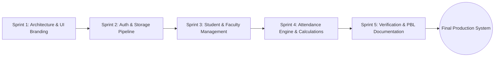

# Software Development Life Cycle (SDLC) Model

**Project:** GM University Student Attendance Management System  
**Methodology Chosen:** Iterative & Incremental Development (Agile Scrum Hybrid)  

---

## 1. Rationale and Justification for the Chosen Model

For the college software engineering Project-Based Learning (PBL) curriculum, the **Iterative & Incremental Model** (incorporating core Agile sprint practices) was selected over the traditional Linear Waterfall Model due to the following specific characteristics:

### Key Justifications:
1. **Visual Identity Replication Requirement:**
   Replicating the visual identity of the live GM University website (`https://www.gmu.ac.in/`) required rapid prototyping and visual validation of CSS tokens, typography, and responsive headers before integrating backend data hooks.
2. **Iterative Feature Verification:**
   Core features—such as automatic account creation for newly enrolled students and duplicate attendance detection—required early, modular unit testing. An iterative approach allowed isolating storage defects before building dashboards.
3. **Low-Risk Scope Adjustments:**
   PBL deadlines require continuous delivery of functional increments. An iterative model guarantees that at the conclusion of every sprint, a working, clickable deliverable exists.
4. **PBL Report Constraints:**
   Iterative feedback loops ensured that functional requirements and UML artifacts (SRS, ER, Use-case, and Test Cases) evolved in lockstep with working code, preventing discrepancies in the final 12-page report.

---

## 2. Sprint Breakdown & Milestones

| Sprint / Iteration | Focus & Objectives | Deliverables Produced |
| :--- | :--- | :--- |
| **Sprint 1 (Days 1–2): Foundation & Branding** | • Analyze `gmu.ac.in` DOM, color palette, and assets. • Synthesize official SVG crest & typography. • Implement responsive CSS design system (`style.css`). | • `assets/gmu-logo.svg` • `assets/gmu-crest.svg` • `css/style.css` |
| **Sprint 2 (Days 3–4): Persistence & Authentication** | • Architect `StorageManager` with distinct `localStorage` keys. • Seed realistic GMU dataset (24+ students, 5 faculty). • Implement role-based authentication and route guards. | • `js/storage.js` • `js/auth.js` • `index.html` portal login |
| **Sprint 3 (Days 5–6): Entity Management (Admin/Faculty)** | • Implement Student CRUD with USN uniqueness validation. • Implement Faculty CRUD and edit modal. • Enable auto-generation of user accounts for new entities. | • `js/students.js` • `js/faculty.js` • `admin-dashboard.html` |
| **Sprint 4 (Days 7–8): Attendance & Analytics Engine** | • Build lecture attendance marking screen. • Integrate "Mark All Present" & duplicate entry locks. • Implement real-time 75% attendance calculations. • Implement CSV export and print stylesheets. | • `js/attendance.js` • `faculty-dashboard.html` • `student-dashboard.html` |
| **Sprint 5 (Days 9–10): Quality Assurance & Documentation** | • Execute 18 test cases across all modules. • Verify cross-browser compatibility and zero console errors. • Compile complete UML diagrams and PBL documentation. | • Test plan matrix • 10 PBL markdown files in `/docs` |

---

## 3. Benefits Realized in This Project
- **Zero Regression:** Modular JavaScript separation (`storage.js`, `auth.js`, `students.js`, `faculty.js`, `attendance.js`) ensured that changes in the attendance calculation engine did not destabilize user authentication.
- **Immediate Feedback:** Testing localStorage operations in browser developer tools at the end of each sprint eliminated data synchronization bugs early.
