# Use-Case Specification & Diagram

**System:** GM University Student Attendance Management System  
**Standard:** UML 2.5 Use-Case Model  

---

## 1. Mermaid Use-Case Diagram

```mermaid
flowchart TD
    subgraph Users ["University Stakeholders"]
        Admin(["⚙ Administrator"])
        Faculty(["👨‍🏫 Faculty Member"])
        Student(["🎓 Student"])
    end

    subgraph AuthBoundary ["Authentication & Session"]
        UC_Login["UC-01: Authenticate with Role"]
        UC_Logout["UC-02: Terminate Session (Logout)"]
        UC_AutoAcc["UC-03: Auto-generate User Account"]
    end

    subgraph AdminBoundary ["Administrator Management Scope"]
        UC_EnrollStudent["UC-04: Enroll Student (Validate USN)"]
        UC_RemoveStudent["UC-05: Remove Student"]
        UC_AddFaculty["UC-06: Appoint Faculty & Assign Subject"]
        UC_EditFaculty["UC-07: Update Faculty Profile"]
        UC_ViewAnalytics["UC-08: View University Attendance Stats"]
        UC_ResetData["UC-09: Reset to Demo Dataset"]
        UC_ExportMaster["UC-10: Export Master Attendance CSV"]
    end

    subgraph FacultyBoundary ["Faculty Instruction Scope"]
        UC_MarkAtt["UC-11: Record Lecture Attendance"]
        UC_MarkAll["UC-12: Bulk Toggle (Mark All Present/Absent)"]
        UC_PreventDup["UC-13: Detect & Confirm Duplicate Session"]
        UC_ViewHist["UC-14: Query Attendance History"]
        UC_CheckRoster["UC-15: Review Class Roster & 75% Shortage"]
    end

    subgraph StudentBoundary ["Student Self-Service Scope"]
        UC_ViewSelfAtt["UC-16: View Personal Attendance Overall %"]
        UC_ViewSubjAtt["UC-17: Track Subject-wise Compliance"]
        UC_AlertShortage["UC-18: Receive Critical 75% Shortage Warning"]
        UC_ExportSelf["UC-19: Download Personal Attendance Report"]
    end

    Admin --> UC_Login
    Admin --> UC_Logout
    Admin --> UC_EnrollStudent
    Admin --> UC_RemoveStudent
    Admin --> UC_AddFaculty
    Admin --> UC_EditFaculty
    Admin --> UC_ViewAnalytics
    Admin --> UC_ResetData
    Admin --> UC_ExportMaster

    Faculty --> UC_Login
    Faculty --> UC_Logout
    Faculty --> UC_MarkAtt
    Faculty --> UC_ViewHist
    Faculty --> UC_CheckRoster

    Student --> UC_Login
    Student --> UC_Logout
    Student --> UC_ViewSelfAtt
    Student --> UC_ViewSubjAtt
    Student --> UC_AlertShortage
    Student --> UC_ExportSelf

    UC_EnrollStudent -.->|<<includes>>| UC_AutoAcc
    UC_AddFaculty -.->|<<includes>>| UC_AutoAcc
    UC_MarkAtt -.->|<<includes>>| UC_MarkAll
    UC_MarkAtt -.->|<<includes>>| UC_PreventDup
```

---

## 2. Core Use-Case Descriptions

### UC-11: Record Lecture Attendance
- **Primary Actor:** Faculty Member
- **Preconditions:** Faculty is logged in and assigned to a course/section.
- **Main Flow:**
  1. Faculty navigates to "Mark Daily Attendance".
  2. Faculty selects Class/Section (e.g., `CSE-A`), Subject (e.g., `Software Engineering`), and Date.
  3. System dynamically loads student roster for the selected class.
  4. System checks if a session record already exists for that date and subject.
  5. Faculty marks individual students or clicks "Mark All Present".
  6. Faculty clicks "Save & Submit Attendance".
  7. System validates data, saves to `localStorage` under `gmu_attendance`, and triggers success notification.
- **Postconditions:** Attendance session is persistently stored; student percentages update in real-time.

### UC-04: Enroll Student (with Auto-Account Generation)
- **Primary Actor:** Administrator
- **Preconditions:** Administrator is logged in.
- **Main Flow:**
  1. Admin opens "Enroll New Student" modal.
  2. Admin enters student details: Name, USN, Class, Semester, Department, Email, Phone.
  3. System validates USN uniqueness.
  4. Upon validation success, student record is appended to `gmu_students`.
  5. System triggers `UC-03` to automatically create a student login account in `gmu_users` with username = USN.
  6. Toast notification confirms enrollment and account credentials.
- **Exceptions:** If USN already exists in database, system aborts enrollment and highlights duplicate error message.
