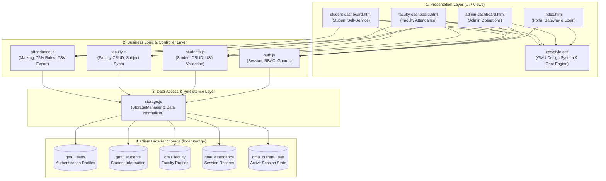

# System Architecture Specification

**System:** GM University Student Attendance Management System  
**Pattern:** Modular Layered Client-Side Architecture (Presentation - Domain Logic - Storage)  

---

## 1. Architectural Overview & Diagram

The GM University Attendance Management System is engineered as a zero-dependency, modular client-side Single-Page/Multi-Page Web Application. It operates entirely within modern web standards (HTML5, CSS3, ES6 JavaScript) without requiring any backend server runtime or compilation step.

---

## 2. Architectural Layer Descriptions

### Layer 1: Presentation Layer
- **Responsibility:** User interaction, role-specific views, modal popups, interactive toggles, responsive menus, and toast notifications.
- **Design Tokens:** Strictly derived from GM University branding manual:
  - Deep Betel Nut Brown (`#4A121A`)
  - University Official Gold (`#E3B559`)
  - Warm Ivory Canvas (`#FAF7F2`)
  - Alert Ruby (`#DC2626` / `#B91C1C` for `< 75%` attendance compliance)
- **Print Optimization:** Supports `@media print` rules, automatically suppressing navigation bars, buttons, and headers to generate clean official attendance transcripts.

### Layer 2: Business Logic & Controller Layer
- **`auth.js`:** Enforces role-based route protection (`requireAuth`), session creation, role verification, and logout handling.
- **`students.js`:** Enforces USN uniqueness, email/phone format validation, search and multi-criteria filtering, and computes personal attendance statistics.
- **`faculty.js`:** Enforces faculty ID uniqueness, subject-to-class mapping, and updates linked login accounts.
- **`attendance.js`:** Validates attendance dates, executes bulk attendance status assignment ("Mark All Present"), detects duplicate sessions for the same class-subject-date tuple, computes percentages, and generates RFC-4180 CSV strings.

### Layer 3: Data Access Layer (`storage.js`)
- **`StorageManager`:** Provides an abstracted interface over the Web Storage API (`localStorage`).
- **Features:** Auto-initialization with realistic university seed data (24+ students, 5 faculty, 4 subjects, historical attendance sessions), isolated namespacing, and an administrative factory reset switch.

### Layer 4: Storage Layer (`localStorage`)
- **Isolation:** Keeps users, students, faculty, and attendance sessions in completely independent key partitions, preventing cross-entity collisions and ensuring clean schema migration.
