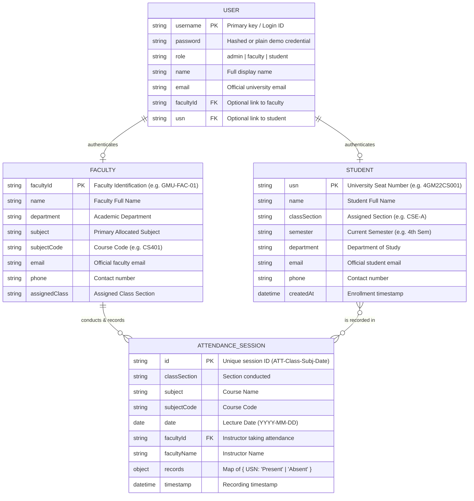
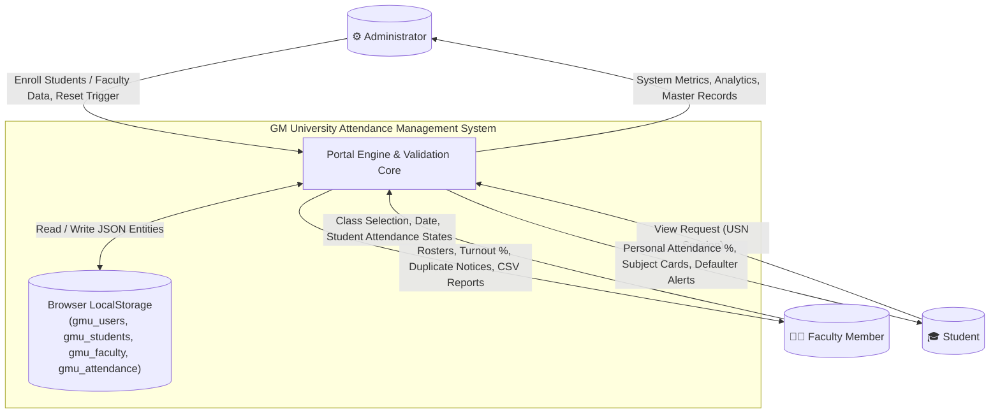

# Entity-Relationship (ER) & Data Flow (DFD) Specifications

**System:** GM University Student Attendance Management System  
**Models:** Entity-Relationship Diagram & Data Flow Diagram (Level 0 / Level 1)  

---

## 1. Entity-Relationship (ER) Diagram

The system maintains 4 primary entities within separate `localStorage` namespaces, maintaining referential integrity through foreign keys:

---

## 2. Data Flow Diagram (DFD Level 0 - Context Diagram)

---

## 3. Data Flow Diagram (DFD Level 1 - Operational Flow)

```mermaid
flowchart LR
    F[Faculty User] -->|1. Selects Class, Subject, Date| P1[1.0 Session Validation]
    P1 -->|Check Existing Session| D1[gmu_attendance]
    D1 -->|Existing Session Data / Null| P1
    
    P1 -->|Load Enrolled Class Roster| D2[gmu_students]
    D2 -->|Student List| P2[2.0 Attendance Marking UI]
    
    F -->|2. Toggle P/A or Mark All Present| P2
    P2 -->|3. Submit Attendance Records| P3[3.0 Conflict & Duplicate Filter]
    P3 -->|Save Verified Session Record| D1
    
    D1 -->|Read History| P4[4.0 Calculation & Defaulter Engine]
    P4 -->|Compute & Compare < 75%| P5[5.0 Alerts & Dashboard Rendering]
    P5 -->|Display Warning Badges| S[Student / Admin / Faculty UI]
```

