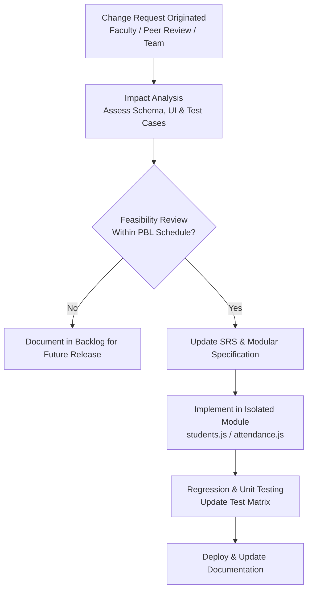

# Requirement Change Management Process

**Project:** GM University Student Attendance Management System  
**Framework:** Agile Change Management Protocol  

---

## 1. Overview
In a software engineering Project-Based Learning (PBL) lifecycle, requirements inevitably evolve as stakeholder expectations are clarified through iterative prototypes. To balance agility with academic deadlines and code stability, a structured **Requirement Change Management (RCM)** process was instituted.

---

## 2. RCM Workflow Steps

1. **Change Identification & Request Logging:**
   - Any team member or faculty reviewer identifies an enhancement or modified business rule (e.g., changing the low-attendance alert threshold from $80\%$ to $75\%$, or adding subject code to session records).
   - The request is documented with: *Change ID, Rationale, Priority, and Affected Modules*.

2. **Impact & Dependency Analysis:**
   - The lead developer analyzes the ripple effect on:
     - **Data Layer:** Schema changes in `localStorage` keys (`gmu_attendance`, `gmu_students`).
     - **Business Logic:** Percentage calculation loops and duplicate prevention logic.
     - **UI Presentation:** CSS class badges, responsive cards, or table columns.
     - **Verification:** Impact on the 18 defined test cases in `07_test_plan.md`.

3. **Approval & Sprint Allocation:**
   - If feasible within the sprint schedule, the change is accepted and assigned an implementation sprint. Low-priority or out-of-scope requests are cataloged in the project backlog.

4. **Implementation & Regression Testing:**
   - Changes are implemented strictly within isolated files (e.g., editing `attendance.js` without altering `auth.js`).
   - The team re-executes all unit and integration test cases to ensure zero regression.

5. **Documentation Synchronization:**
   - The SRS (`02_srs.md`), ER diagram (`06_er_dfd_diagram.md`), and test matrix are updated immediately to maintain 100% traceability.

---

## 3. Concrete Example of Change Handled
- **Requested Change (CR-02):** Faculty requested a bulk shortcut to toggle all students to "Present" during attendance entry to expedite lecture registration.
- **Impact Evaluation:** Low risk to storage schema; required adding a "Mark All Present" button and iterating the current DOM card states in `faculty-dashboard.html` / `attendance.js`.
- **Outcome:** Successfully implemented, tested (TC-12 passed), and documented within Sprint 4 without impacting student or admin workflows.
